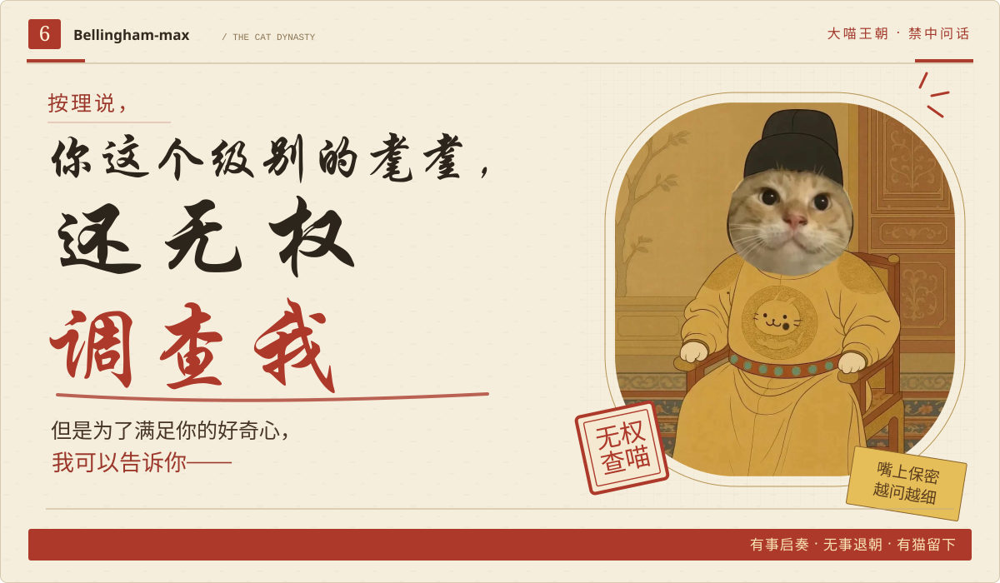
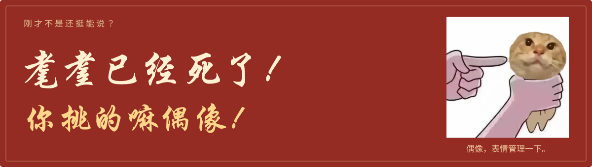
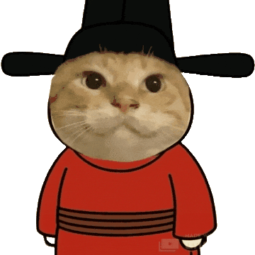

  

按理说，你这个级别的耄耋，还无权调查我，但是为了满足你的好奇心，我可以告诉你——

<b>那你说，我听着。</b>

  <a href="https://github.com/Bellingham-max?tab=repositories">📜 藏经阁</a> ·
  <a href="https://github.com/Bellingham-max?tab=overview">🐾 起居注</a>

### 🐈 问话现场

<table>
  <tr>
    <td align="center" width="33%"><b>第一轮 · 口供</b></td>
    <td align="center" width="34%"><b>第二轮 · 追问</b></td>
    <td align="center" width="33%"><b>第三轮 · 指认</b></td>
  </tr>
  <tr>
    <td align="center"></td>
    <td align="center"></td>
    <td align="center"></td>
  </tr>
  <tr>
    <td align="center">你是谁？ 它说我是你。</td>
    <td align="center">它怎么知道？ 它也没问。</td>
    <td align="center">那我是谁？ 你先证明一下。</td>
  </tr>
</table>

### 📜 本案疑点

> 我有不在场证明。  
> 当时我在别人的号上。

🔴 密诏：凡人勿点

你已获得本朝最高机密：**朕也不会，但朕的AI会**

有事启奏 · 无事退朝 · 有猫留下

